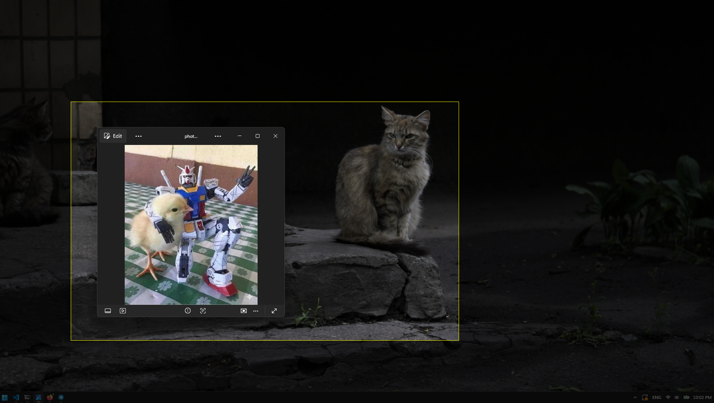

# screenshot

A screenshot application for Windows

`Alt+Shift+P` - To open the screenshot window

`Ctrl+C` - To copy the screenshot to the clipboard  
`Ctrl+S` - To save the screenshot (In the user's Pictures folder)

Quick screenshot is turned on by default, to turn it off, uncheck it in tray menu

# TODO

1. Resizing the selected area
2. Ability to change hotkey without changing code and recompiling the program
3. Option to capture the cursor
4. Option what quick screenshot should do (save, copy or both)
